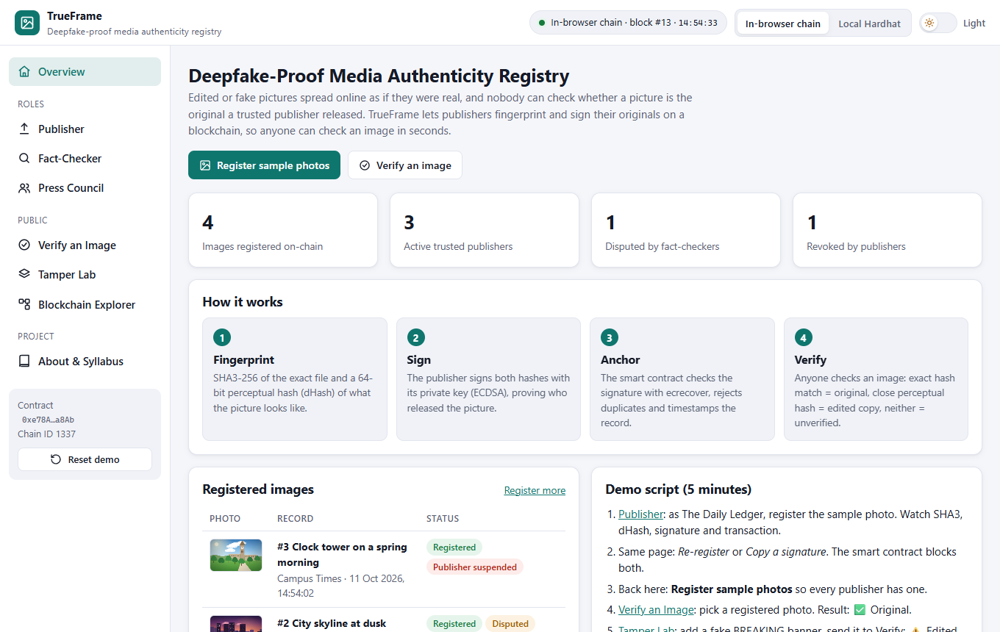
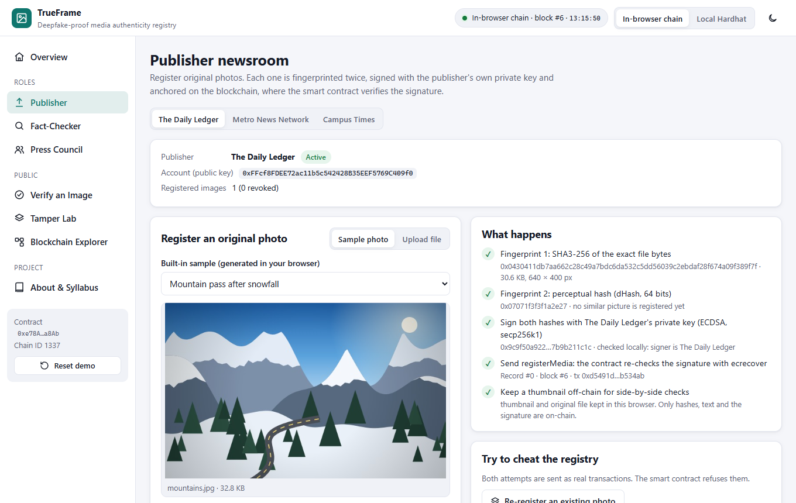
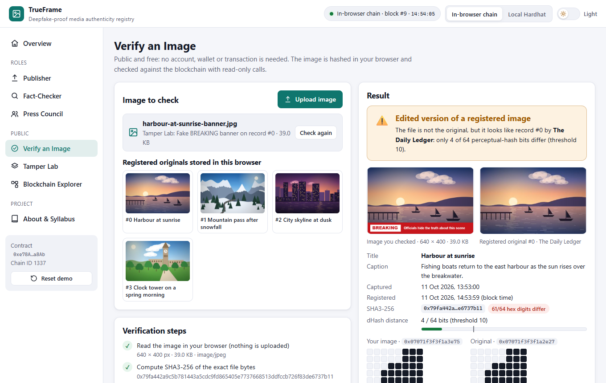
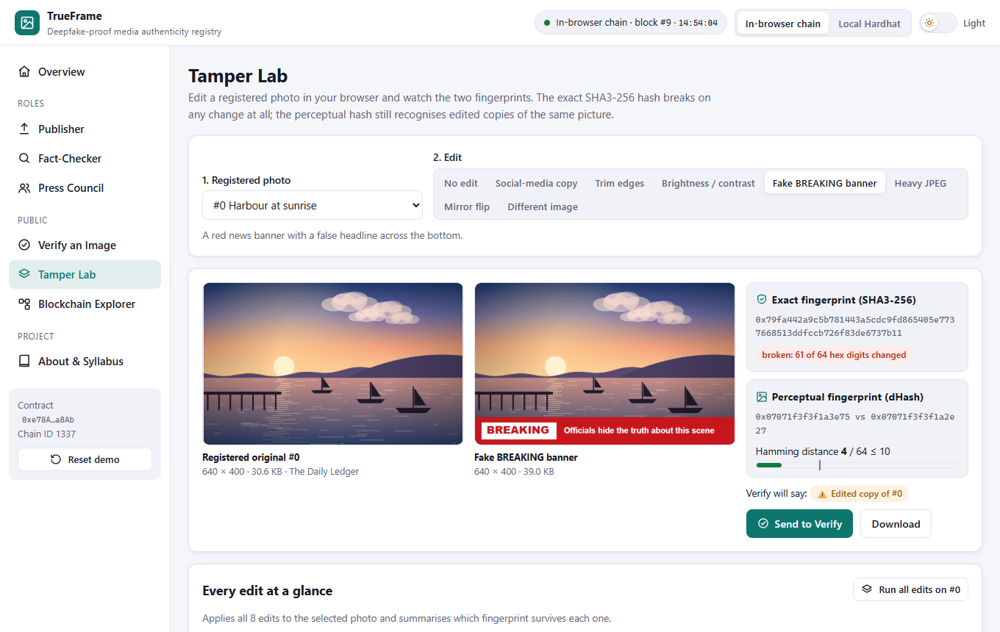
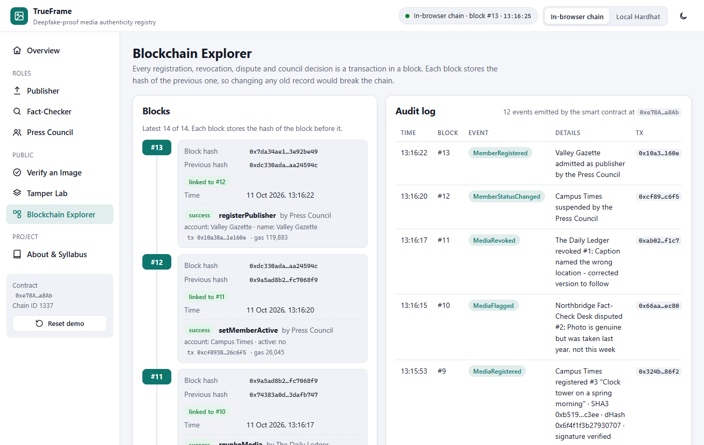
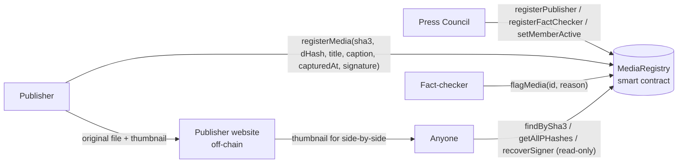

# TrueFrame: Deepfake-Proof Media Authenticity Registry

Trusted publishers register their **original images** on a blockchain with an exact SHA3-256 hash, a perceptual hash and an ECDSA signature, so **anyone can check** whether a picture is the original, an edited copy, or unverified.

**Live demo:** https://syedareeb06.github.io/media-authenticity-registry/ (runs entirely in your browser: no wallet, no install, no real cryptocurrency)



---

## The problem

Edited or fake images spread online as if they were real. Today:

- a cropped photo with a false caption, or a picture from another year, looks just as convincing as the original,
- nobody can check whether a picture is the one a trusted publisher actually released, and
- anyone can claim "this photo is from a news agency" without proof.

## The solution

| Step | What happens | Technique |
|---|---|---|
| 1. Fingerprint | The publisher's browser computes the **SHA3-256** hash of the exact file and a 64-bit **perceptual hash (dHash)** of what the picture looks like. | SHA-3 (FIPS 202), dHash on `<canvas>` |
| 2. Sign | The publisher signs both hashes with its own private key. | ECDSA (secp256k1), EIP-191 message |
| 3. Anchor | The smart contract checks the signature with `ecrecover`, rejects duplicates and future capture times, and timestamps the record. Only publishers admitted by the Press Council may register. | Solidity smart contract, permissioned consortium |
| 4. Verify | Anyone uploads an image. Exact SHA3 match = **Original**. Perceptual hash within 10 of 64 bits = **Edited version** (shown side by side with the original). Neither = **Unverified**. | Hamming distance, read-only contract calls |

## Features

- **Publisher**: register built-in sample photos or your own image (max 5 MB) with live steps (SHA3, dHash, signature, transaction); revoke your own records; try to cheat (re-register an image, copy a signature) and watch the contract refuse
- **Verify an Image** (public, no account): upload a file or pick a registered original; verdict, side-by-side comparison, hash details and the 64 dHash bits with differences highlighted
- **Tamper Lab**: apply edits in the browser (social-media recompression, trim, brightness/contrast, fake BREAKING banner, heavy JPEG, mirror flip, a different image) and send the result to Verify
- **Fact-Checker**: dispute a record with a public reason (shown to every verifier)
- **Press Council**: admit publishers and fact-checkers, suspend or re-activate them, see open disputes
- **Blockchain Explorer**: hash-linked blocks, decoded transactions and the full audit log
- Two blockchains: an **in-browser Ethereum chain** (zero setup) or a **local Hardhat node**
- **Light / dark theme switch** in the top bar (follows your system theme until you choose, then remembers it)

| Publisher registers a photo | Verify: edited copy found |
|---|---|
|  |  |

| Tamper Lab | Blockchain explorer |
|---|---|
|  |  |

## Syllabus mapping (22CS743, Blockchain Technology)

| Module | Concepts | Where they appear in this project |
|---|---|---|
| **II** | Cryptographic hash functions (SHA-3), hash-linked blocks | SHA3-256 (the real FIPS 202 SHA-3, not keccak256) of every file vs a perceptual dHash compared by Hamming distance; the explorer checks each block's previous-hash link |
| **III** | Ethereum, EVM, smart contracts, digital signatures | `MediaRegistry.sol` splits the 65-byte signature, rejects bad `v` and malleable `s`, recovers the signer with `ecrecover` over an EIP-191 digest and requires signer = sender |
| **IV** | Permissioned / consortium blockchain | The Press Council admits and suspends publishers and fact-checkers; roles are enforced on-chain |
| **V** | Security, identity, privacy, applications | Misinformation and deepfake defence, publisher identity through keys, revocation and disputes, only hashes on-chain |

## Architecture



**On-chain:** members and roles, SHA3-256 and dHash of each image, title, caption, capture time, block time, the 65-byte signature, revocations and disputes.
**Off-chain:** the image files. The demo keeps a 360 px thumbnail (and originals up to 400 KB) in browser storage, standing in for the publisher's website.

The message a publisher signs is `keccak256("TrueFrame" ‖ chainId ‖ contractAddress ‖ sha3Hash ‖ pHash)`, so a signature cannot be reused for another image, another contract or another chain.

## Tech stack

- **Smart contract:** Solidity 0.8.24, Hardhat (local blockchain, tests, deployment)
- **Frontend:** HTML, CSS, JavaScript (no build step), ethers.js v6, js-sha3 (SHA3-256), Canvas API
- **Demo blockchain:** Ganache running inside the browser (same EVM, same contract)
- **Hosting:** GitHub Pages

## Project structure

```
media-authenticity-registry/
├── blockchain/                    # Smart contract project (Hardhat)
│   ├── contracts/MediaRegistry.sol
│   ├── test/MediaRegistry.test.js      # 23 unit tests
│   ├── scripts/deploy.js               # deploy + admit demo consortium on localhost
│   ├── scripts/export-artifact.js      # copy ABI + bytecode into the web app
│   └── hardhat.config.js
├── frontend/                      # Web app (open index.html)
│   ├── index.html
│   ├── css/
│   ├── js/app.js                  # TrueFrame screens and logic
│   ├── js/trueframe-crypto.js     # SHA3-256, dHash, Hamming distance, ECDSA sign/recover
│   ├── js/image-lab.js            # synthetic sample photos and Tamper Lab edits
│   ├── js/chain.js                # in-browser chain / local Hardhat connection
│   ├── js/contract-artifact.js    # compiled contract (generated)
│   └── vendor/                    # ethers.js, Ganache, js-sha3 (browser builds)
├── docs/screenshots/
└── index.html                     # redirects GitHub Pages to frontend/
```

## How to run

### Option 1: Zero install (recommended for demos)

Open the [live demo](https://syedareeb06.github.io/media-authenticity-registry/), **or** double-click `frontend/index.html`.
An Ethereum blockchain starts inside the page. Your data is saved in the browser; click **Reset demo** in the sidebar to start over.

### Option 2: Local Hardhat blockchain

Requires [Node.js](https://nodejs.org/) 18 or newer.

```bash
cd blockchain
npm install
npm run node
```

Keep that terminal open. In a second terminal:

```bash
cd blockchain
npm run deploy
```

Then open `frontend/index.html` and click **Local Hardhat** in the top bar. (If you skip `npm run deploy`, the app deploys the contract itself.)

### Run the smart contract tests

```bash
cd blockchain
npm test
```

### After changing the contract

```bash
cd blockchain
npm run export
```

This recompiles and copies the new ABI and bytecode into `frontend/js/contract-artifact.js`.

## 5-minute demo script

1. **Publisher** → as The Daily Ledger, click *Fingerprint, sign & register*. Watch the 5 steps (SHA3, dHash, signature, transaction, thumbnail).
2. Same page → *Re-register an existing photo* and *Copy a signature onto a staged photo*. The smart contract blocks both.
3. **Overview** → *Register sample photos* so every publisher has one.
4. **Verify an Image** → pick a registered photo: **✅ Original**.
5. **Tamper Lab** → *Fake BREAKING banner* → *Send to Verify*: **⚠️ Edited version of #0**, side by side with the original. Try *Mirror flip* and *Different image*: **❌ Unverified**.
6. **Fact-Checker** disputes a caption, the **Publisher** revokes a photo, the **Press Council** suspends a publisher. Verify shows each warning.
7. **Blockchain Explorer**: show the hash-linked blocks and the audit log.

## Publishing on GitHub Pages

1. Push this folder to a GitHub repository named `media-authenticity-registry`.
2. On GitHub: **Settings → Pages → Build and deployment → Source: Deploy from a branch → Branch: `main`, folder: `/ (root)` → Save**.
3. After about a minute the site is live at `https://syedareeb06.github.io/media-authenticity-registry/`.

## Limitations and future work

- TrueFrame proves where a picture came from. An "Unverified" image is not proven fake, and a registered photo can still carry a misleading caption (that is what disputes are for).
- dHash survives resizing, recompression, brightness changes and small banners, but **not mirror flips, rotations or large crops** (the Tamper Lab shows this). Production systems combine several perceptual hashes or learned image embeddings.
- The similarity scan reads every 64-bit hash and compares them in the browser. That is fine for thousands of records; millions would need an off-chain index (for example a BK-tree) anchored to the chain.
- If a publisher's private key is stolen, the thief can register in its name until the Press Council suspends the account. Real publishers would use hardware wallets.
- In the demo, image files live in browser storage. A real deployment would serve them from each publisher's website or IPFS, and could embed the record id in the image metadata (as C2PA does).

## License

MIT, see [LICENSE](LICENSE). Bundled libraries keep their own licenses: ethers.js (MIT), Ganache (MIT), js-sha3 (MIT, see `frontend/vendor/sha3.LICENSE.txt`).
